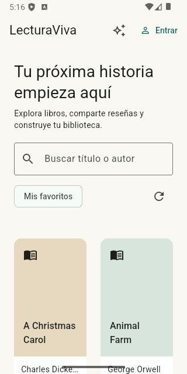
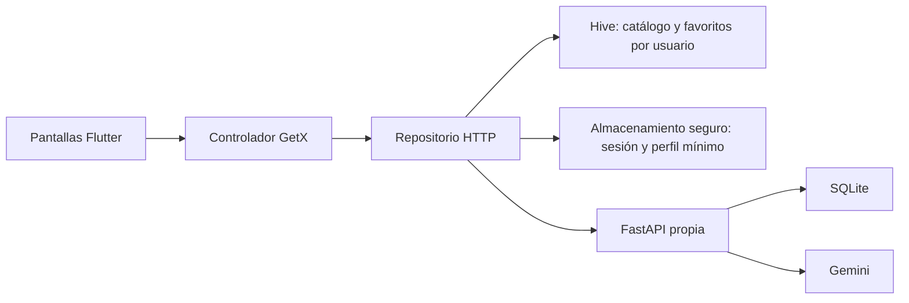

# LecturaViva

Catálogo original de libros con reseñas, favoritos y recomendaciones de Gemini. Proyecto final desarrollado en Windows con Antigravity. **GitHub Actions aprobado y APK del Release instalado y comprobado en Android 35.**

[Repositorio](https://github.com/a-quinamera/lecturaviva-proyecto-final) · [Release v1.0.0](https://github.com/a-quinamera/lecturaviva-proyecto-final/releases/tag/v1.0.0) · [CI de la republicación](https://github.com/a-quinamera/lecturaviva-proyecto-final/actions/runs/39194767245)



## Estado comprobado

- 25 libros de Open Library importados a SQLite; búsqueda, detalle y reseñas públicas con autorización por propietario.
- 16 pruebas de backend y 19 pruebas de Flutter aprobadas. Análisis de lib y test sin incidencias.
- Gemini 3.5 Flash-Lite respondió a través del backend con recomendaciones del catálogo. La clave fue configurada localmente por la persona.
- Compilación web correcta. APK local Android x64 en modo Release instalado en un emulador nuevo Android 35; catálogo, login y restauración de sesión después de un cierre completo comprobados.
- Comprobados en Android: asistente Gemini, favoritos tras reinicio y CRUD de reseñas. Una segunda cuenta en Brave vio los cambios y no pudo modificar reseñas ajenas (403). Error de conexión y recuperación comprobados. Repositorio y Release publicados; APK universal generado por Actions, descargado, instalado desde cero y probado en el emulador. Detalles en [PRUEBAS](docs/PRUEBAS.md) y [CONTINUAR](docs/CONTINUAR.md).

## Ejecutar en Windows

Requisitos: Flutter 3.44.1 / Dart 3.12.1, Python 3.11+, Java 21 y SDK Android con emulador. Si Gradle rechaza una ruta con caracteres como «ñ», copiar el proyecto de trabajo a una ruta temporal sin esos caracteres antes de compilar.

Obtener el código:

```powershell
git clone https://github.com/a-quinamera/lecturaviva-proyecto-final.git
cd lecturaviva-proyecto-final
```

Desde la raíz del proyecto:

```powershell
cd backend
python -m venv .venv
.\.venv\Scripts\python.exe -m pip install -r requirements.lock
if (-not (Test-Path .env)) { Copy-Item .env.example .env }
# En Antigravity: introducir GEMINI_API_KEY únicamente en .env.
.\.venv\Scripts\python.exe -m uvicorn main:app --host 127.0.0.1 --port 8001
```

En otra terminal, desde la raíz:

```powershell
cd lecturaviva
flutter pub get
flutter run -d web-server --web-hostname localhost --web-port 8190
```

Abrir http://localhost:8190/ en Brave. La API y su documentación están en http://localhost:8001/health y http://localhost:8001/docs. En el emulador Android, el alias del equipo es http://10.0.2.2:8001; el APK lo usa por defecto. El backend debe estar iniciado en el mismo equipo.

Para desarrollar directamente en Android, iniciar un emulador y ejecutar `flutter run`. Para una API desplegada, compilar con `flutter build apk --release --dart-define=API_BASE_URL=https://tu-servidor.example`. Android permite HTTP local exclusivamente para 10.0.2.2; los demás destinos requieren HTTPS.

## Verificación y entrega

```powershell
# Desde backend
.\.venv\Scripts\python.exe -m pytest test_api.py -q
# Desde lecturaviva
flutter analyze
flutter test
flutter build web --release
flutter build apk --release
```

Descargar [app-release.apk del Release v1.0.0](https://github.com/a-quinamera/lecturaviva-proyecto-final/releases/download/v1.0.0/app-release.apk). Fue generado originalmente por GitHub Actions y se restauró desde el respaldo verificado al recrear el repositorio. La [CI actual](https://github.com/a-quinamera/lecturaviva-proyecto-final/actions/runs/39194767245) vuelve a comprobar las mismas fuentes. Con el emulador Android activo, desde la carpeta donde se descargó:

```powershell
adb install app-release.apk
```

El backend debe estar activo en el mismo equipo en el puerto 8001. Crear una cuenta desde «Entrar → Crear una cuenta». Para probar colaboración, registrar otra cuenta y actualizar las reseñas del mismo libro. No se distribuyen usuarios ni contraseñas preconfigurados.

APK universal: 51 589 062 bytes; SHA256 `f39ab65a2282796936256d786514f47300f79297322fec3db3f1b9bba6b6742b`. Se verificó el hash publicado por GitHub, la instalación limpia, el arranque, el catálogo y el registro de una cuenta sintética en Android 35. Está firmado con la configuración académica de pruebas del proyecto.

La [CI del repositorio recreado](https://github.com/a-quinamera/lecturaviva-proyecto-final/actions/runs/39194767245) verifica el backend y Flutter, incluyendo sus pruebas y compilaciones. El Release conserva el mismo APK previamente comprobado; la recreación cambió el historial y la autoría, sin modificar las fuentes de la aplicación. El workflow también automatiza futuros Releases para etiquetas v* cuando pasan ambas comprobaciones. **En Moodle se entrega solo el enlace del repositorio**; el APK permanece en Releases.

## Arquitectura y seguridad



Se eligió SQLite para que el backend pueda reproducirse en un equipo con Python, sin depender de un servicio de base de datos externo. Una instalación con varias instancias requeriría migrar a una base compartida. Las reseñas son públicas para lectura; crear, editar o eliminar requiere autenticación; editar o eliminar reseñas ajenas devuelve 403.

Las contraseñas se derivan con PBKDF2 y las sesiones JWT caducan a las dos horas. El token y el perfil mínimo se guardan con flutter_secure_storage; los favoritos y el catálogo usan Hive. Sin red se pueden consultar los datos locales; los cambios remotos siguen requiriendo autorización del servidor.

La clave de Gemini vive en backend/.env o en la variable de entorno del servidor. Gemini recibe catálogo, consulta e IDs de favoritos; no recibe contraseñas, correos ni JWT. .env, bases de datos y claves locales quedan fuera de Git. [Guía de configuración](docs/GEMINI.md).

## Créditos

Metadatos: [Open Library](https://openlibrary.org), con procedencia y fecha en [FUENTES](docs/FUENTES.md). No se distribuyen libros completos ni portadas. Las cubiertas tipográficas son parte de la interfaz original. Flutter/Material, GetX, Hive, http, flutter_secure_storage, Cupertino Icons, FastAPI y las demás dependencias conservan sus respectivas licencias; las versiones resueltas constan en pubspec.lock y requirements.lock. Consulta [licencias y atribución](docs/LICENCIAS.md).
