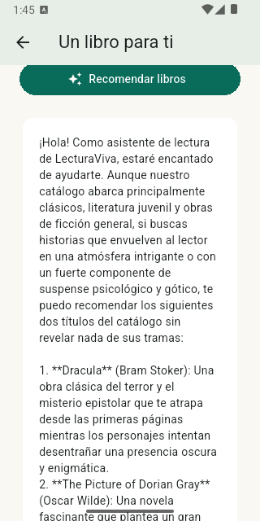
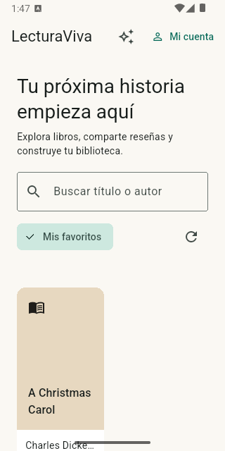
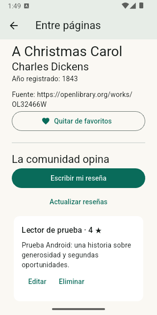
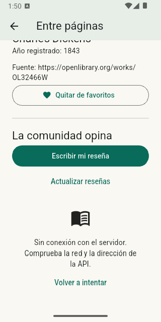
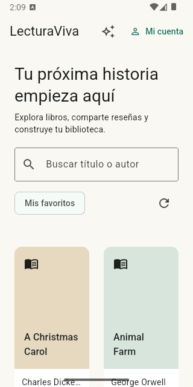

# Resultados comprobados — 17/10/2026

| Comprobación | Resultado |
|---|---|
| Backend: autenticación, autorización, catálogo y proxy Gemini simulado | 16 pruebas pasadas |
| Flutter: HTTP 400/401/403/404/422/500/503, timeout y red | Pasadas |
| Flutter: Hive reabierto, favoritos por usuario y restauración segura | Pasadas |
| Flutter: sesión caducada, respuestas tardías de reseñas e IA tras logout | Pasadas |
| Flutter: catálogo y búsqueda a 360 px | Sin desbordamientos |
| Total Flutter / análisis lib y test | 19 pruebas pasadas / sin incidencias |
| Android 35: APK Release x64 | Instalado y ejecutado en LecturaViva_Limpio |
| Android: sesión y favoritos | Conservados tras force-stop y arranque COLD |
| Android: asistente con Gemini real | Recomendó Dracula y The Picture of Dorian Gray desde la interfaz, por el backend propio |
| Android: CRUD de reseña propia | Creada con 5 estrellas, editada a 4 y eliminada con confirmación |
| Colaboración Android → Brave | Una segunda cuenta vio la reseña con 4 estrellas sin botones de edición/eliminación; dejó de verla tras eliminarla el autor y actualizar |
| API real: autorización por propietario | PUT y DELETE con el token de la segunda cuenta devolvieron 403; la reseña original permaneció intacta |
| Brave: persistencia | Sesión y favorito Frankenstein restaurados tras recargar la aplicación |
| Android y Brave: servidor apagado | Mensaje de falta de conexión y botón Volver a intentar visibles; recuperación tras reiniciar el backend |
| Sesión Android caducada | Aviso explícito; arranque posterior sin sesión, nuevo login correcto |
| Reproducción Windows desde cero | venv nuevo, instalación completa de requirements.lock, API con 25 libros; usuario y reseña persistieron al reiniciar el backend |
| GitHub Actions / Release universal | Dos ejecuciones aprobadas: main y v1.0.0; Release y APK publicados automáticamente |
| APK descargado de Actions | SHA256 coincide con GitHub; instalación limpia Success y arranque COLD Status ok en Android 35; catálogo y registro real correctos |

Se probaron dos cuentas sintéticas en una base de integración aislada fuera del repositorio. La clave Gemini permaneció en backend/.env; no se incluyó en Flutter, Git ni registros. Las pruebas automáticas del proveedor usan un doble y no requieren una clave.

## Evidencia Android

## APK de entrega

[Release v1.0.0](https://github.com/a-quinamera/lecturaviva-proyecto-final/releases/tag/v1.0.0), generado por [Actions](https://github.com/a-quinamera/lecturaviva-proyecto-final/actions/runs/39088615879). Tamaño: 51 589 062 bytes. SHA256: f39ab65a2282796936256d786514f47300f79297322fec3db3f1b9bba6b6742b. Se eliminó la instalación de prueba anterior del emulador aislado LecturaViva_Limpio, se instaló este APK con Success y se abrió con arranque COLD Status ok. El catálogo de 25 libros y el registro de una nueva cuenta sintética funcionaron contra el backend propio.

La etiqueta del Release conserva el commit original que ejecutó Actions, c1b4df4ebfa6e3957b139ce46e6292258799bf5b, para preservar la trazabilidad del binario. Posteriormente se normalizó la identidad de los commits de main a a-quinamera por solicitud de la persona; se conservaron sus fechas, mensajes y árboles de archivos. Los cambios de cierre posteriores son documentación y capturas, sin modificaciones del código del APK.

El APK local x64 anterior permanece fuera de Git, junto con la copia descargada de Actions. Ambos usan la API del equipo por 10.0.2.2:8001 y firma académica de pruebas. Los errores HTTP específicos se cubrieron automáticamente; el fallo de conexión y la caducidad de sesión también se observaron en la interfaz real.
